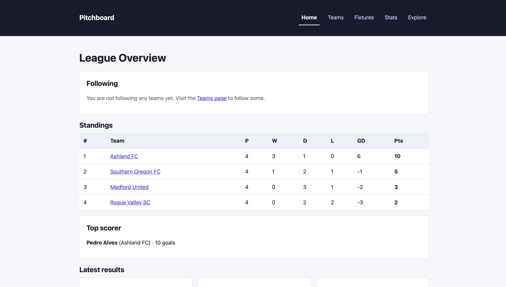
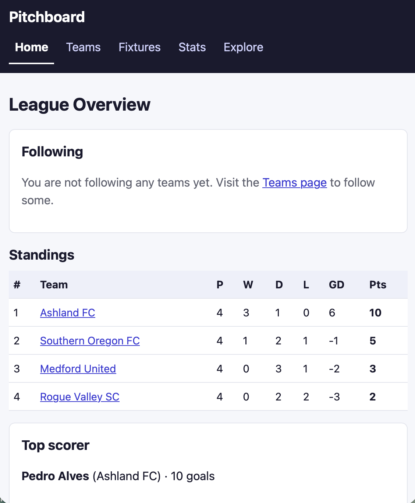
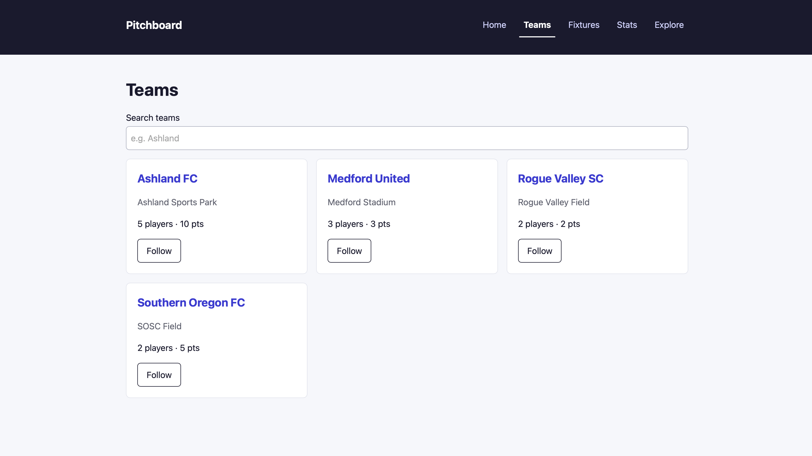
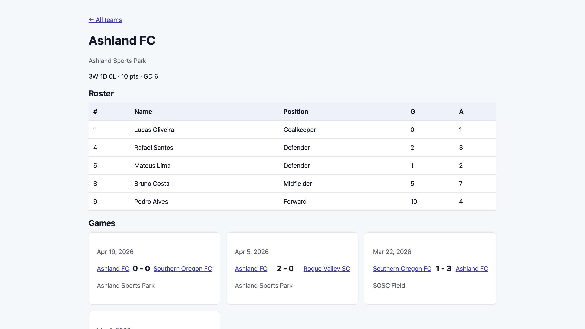

# Pitchboard

Pitchboard is a React single page application for amateur sports leagues. It replaces group chats and spreadsheets with one place to see standings, results, fixtures, rosters, and player stats. This is the MVP of my Application Development Frontend 2 capstone project.

**Live site:** https://pitchboard-league-tracker.vercel.app
**Frontend repo:** https://github.com/jmaia173/pitchboard-league-tracker
**Backend repo:** https://github.com/jmaia173/Application-Development-1-Backend_Final_Project
**Backend API:** https://sports-league-api.onrender.com

> The API runs on a free Render plan, so the first request after a period of inactivity can take about 30 seconds while it wakes up.

## Screenshots

| Home (desktop) | Home (mobile) |
|---|---|
|  |  |

| Teams | Team detail |
|---|---|
|  |  |

## Technologies Used

- React with Vite
- React Router (client-side routing)
- React Context API with `useReducer`
- Vitest, React Testing Library, and jsdom for tests
- Plain CSS, mobile-first, with media queries at 768px and 1024px
- Vercel (frontend hosting) and Render (backend hosting)

## Features

- League standings calculated in the browser from game results (3 points for a win, 1 for a draw, then goal difference)
- Results and upcoming fixtures
- Team list with search, and team pages with rosters and games
- Top scorers and top assists
- Follow teams (saved in the browser)
- Explore page that searches professional teams through TheSportsDB
- Loading and error states for every API request, and a 404 page

## Routes

| Route | Page |
|---|---|
| `/` | Home: followed teams, standings, top scorer, latest results |
| `/teams` | Team cards with search and follow buttons |
| `/teams/:teamId` | Team roster, record, and games |
| `/fixtures` | Results and upcoming games |
| `/stats` | Top scorers and top assists |
| `/explore` | TheSportsDB team search |
| `*` | 404 Not Found |

## Component Organization

```
src/
  components/   Reusable UI (props and composition)
  pages/        One component per route
  contexts/     Global state (Context API)
  services/     API calls (fetch wrappers)
  utils/        Pure logic (standings, stats, dates)
  tests/        Vitest test files
```

| Layer | Files | Responsibility |
|---|---|---|
| Layout | `App.jsx`, `Header` | Routes, navigation, loading and error gate |
| Pages | `Home`, `Teams`, `TeamDetail`, `Fixtures`, `Stats`, `Explore`, `NotFound` | Read from context, arrange components |
| Presentational components | `TeamCard`, `GameCard`, `StandingsTable`, `StatList`, `ExploreCard`, `FollowButton` | Display data passed in through props |
| Status components | `Loading`, `ErrorMessage` | Shared request states |
| Contexts | `LeaguesProvider`, `FollowProvider` | Global state |
| Services | `api.js`, `sportsdb.js` | All network requests |
| Utils | `standings.js`, `stats.js`, `games.js` | Pure functions, easy to test |

Data flow: pages and components read global state through the `useLeagues` and `useFollow` hooks, and receive display data from their parents through props.

## State Management

**Local state (`useState`):** team search text, the Fixtures results/upcoming toggle, and the Explore search input and results.

**Global state (Context API):**
- `LeaguesContext` (`useReducer`) holds teams, players, games, loading, and error. It exposes derived `standings`. Reducer actions: `FETCH_START`, `FETCH_SUCCESS`, `FETCH_ERROR`, `UPDATE_GAME`. `UPDATE_GAME` replaces one game immutably, and standings recompute from it automatically.
- `FollowContext` holds followed team ids and `toggleFollow`, saved to `localStorage`.

## API Documentation and Dependencies

**Pitchboard API** (my own Express, Sequelize, and SQLite backend, public read access):

| Method | Endpoint | Used for |
|---|---|---|
| GET | `/teams` | Teams with coach and players |
| GET | `/players` | Players with team, goals, and assists |
| GET | `/games` | Games with nested `homeTeam` and `awayTeam` |

**TheSportsDB:** `GET /api/v1/json/{key}/searchteams.php?t={name}` for the Explore page.

Create, update, and delete routes and JWT authentication exist on the backend and will be used in the final version.

## Setup and Installation

Requirements: Node.js 20 or newer.

```bash
git clone https://github.com/jmaia173/pitchboard-league-tracker.git
cd pitchboard-league-tracker
npm install
```

Create a `.env` file in the project root:

```
VITE_API_URL=https://sports-league-api.onrender.com
VITE_SPORTSDB_KEY=123
```

Start the dev server:

```bash
npm run dev
```

Other scripts:

```bash
npm test        # run the Vitest suite once
npm run build   # production build
npm run lint    # ESLint
```

## Testing

Vitest with React Testing Library covers: standings calculation, player stat helpers, the reducer (including immutability), `GameCard`, `StandingsTable`, `FollowContext` (toggle and persistence), and the Teams page (rendering, search filter, empty state).

## Deployment

Deployed on Vercel from the `main` branch, with automatic deploys on every push. Set these environment variables in the Vercel project:

- `VITE_API_URL`
- `VITE_SPORTSDB_KEY`

`vercel.json` rewrites all paths to `index.html` so direct links and refreshes work with client-side routing.

## Known Issues

- Seeded games are all in the past, so Upcoming fixtures is empty until new games are added.
- The free-tier API has a cold start of about 30 seconds.
- Followed teams are stored per browser, not per account.
- `/login`, `/register`, and `/dashboard` are not built yet.

## Future Enhancements (Final Submission)

- Standalone `/login` and `/register` pages with JWT authentication (`AuthContext`)
- Protected `/dashboard` for organizers and coaches: record results, edit rosters
- Multi-league support
- Server-side statistics
- Real-time updates
- Improved persistence and security
- More test coverage
